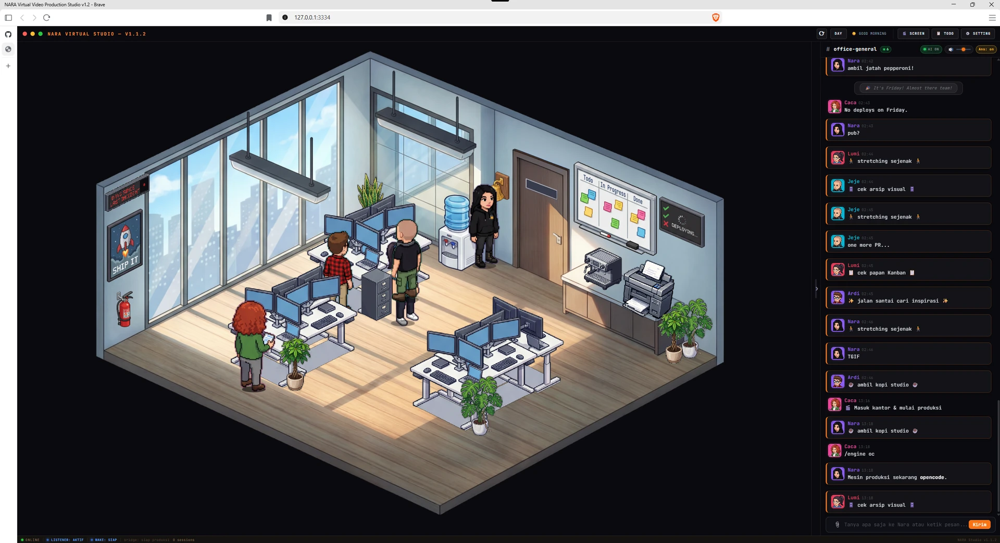
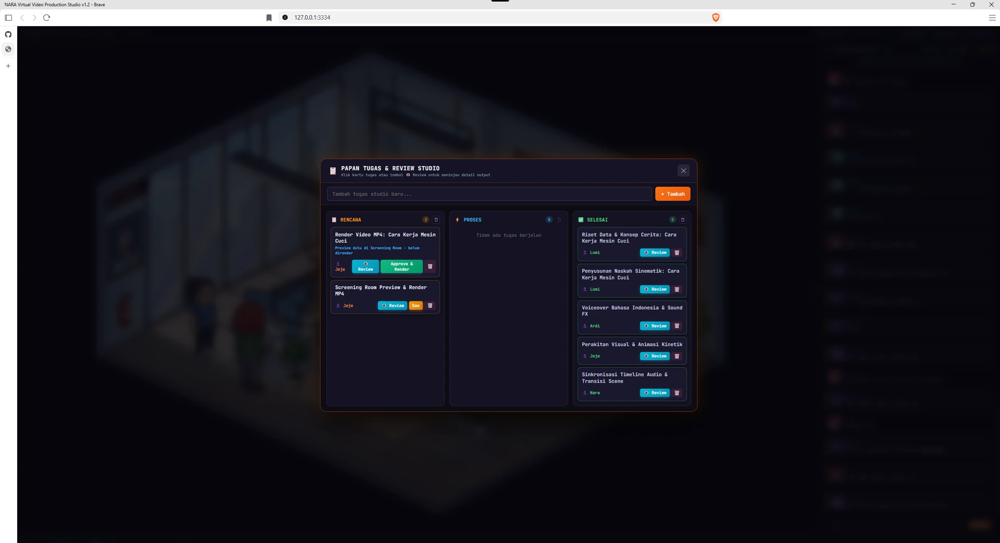
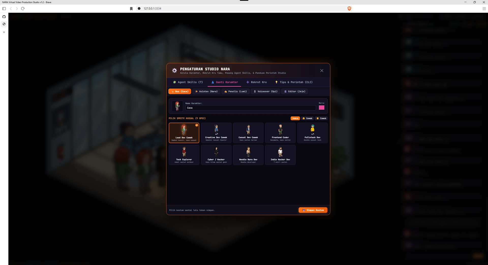
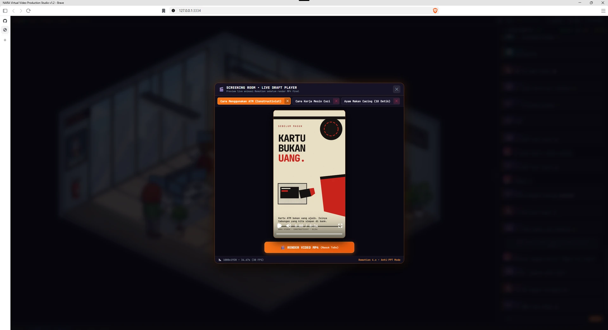
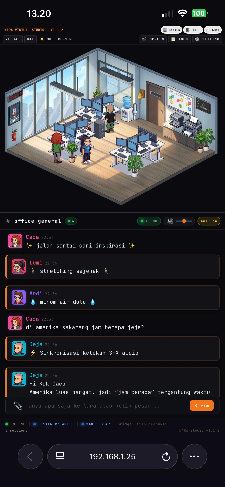
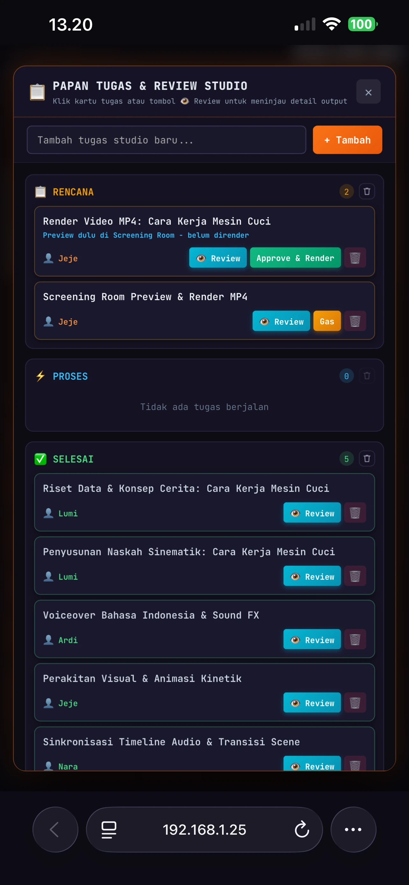
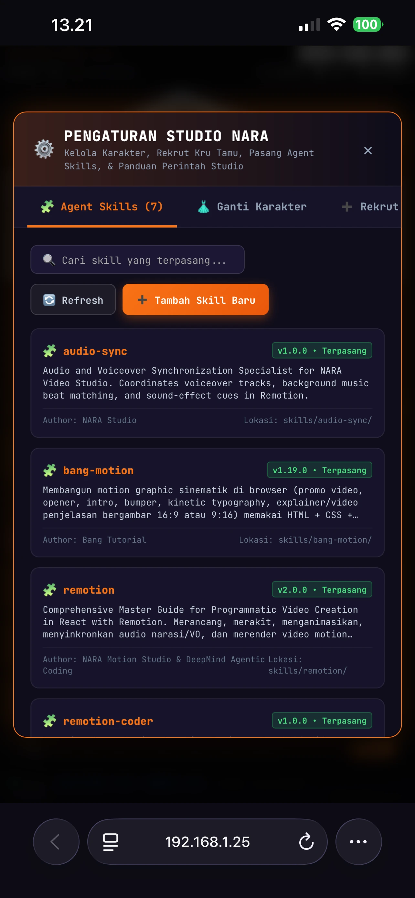
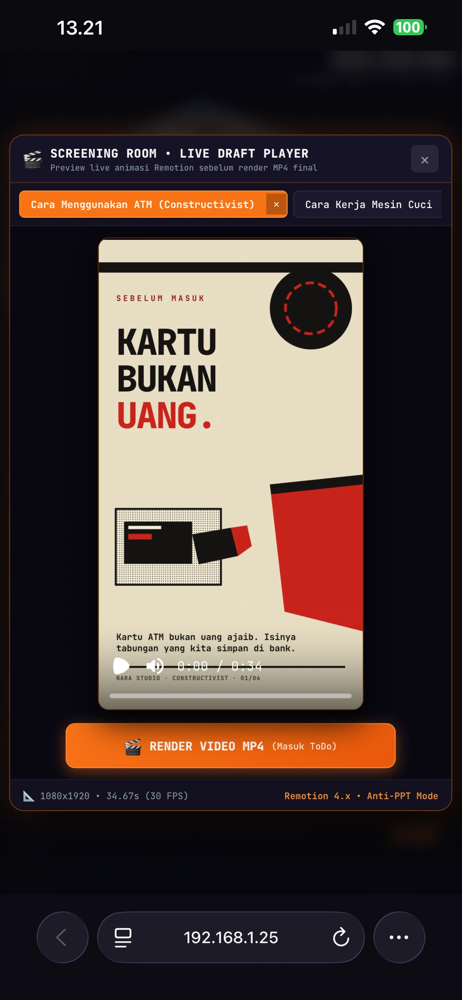

# 🎬 NARA Virtual Video Production Studio

> **Kantor virtual isometrik + studio produksi video otomatis untuk DeepSeek, Antigravity (AGY), dan OpenCode.**  
> React · Remotion 4.x · Edge-TTS · Express · WebSocket

NARA Studio menggabungkan kantor virtual pixel-art isometrik dengan mesin produksi video React (Remotion) yang dilengkapi naskah otomatis, voiceover Bahasa Indonesia (Edge-TTS), sound effects (SFX), dan chat tim AI yang terhubung ke internet & jam dunia real-time.

**Repo:** <https://github.com/carissadarmafissaleha/nara-studio-virtual>

<p align="center">
  <a href="https://sociabuzz.com/narra_dev">
    
  </a>
  <a href="https://sociabuzz.com/narra_dev">
    
  </a>
</p>

<p align="center">
  
  <br />
  <sub><b>Kantor virtual isometrik NARA Studio</b> — kru AI bekerja di meja masing-masing, chat tim berjalan real-time, status <code>LISTENER</code> &amp; <code>WAKE</code> tampil di footer.</sub>
</p>

---

## 📚 Tutorial Lengkap per Mesin

Panduan langkah-demi-langkah untuk tiap mesin, dari clone sampai MP4:

| Mesin                 | Tutorial                                          | Stack                         | Ganti mesin               | Wake (di sesi mesin)    |
| :-------------------- | :------------------------------------------------ | :---------------------------- | :------------------------ | :---------------------- |
| **Antigravity (AGY)** | [tutorial-agy.md](docs/tutorial-agy.md)           | `npm run dev:office-agy`      | `/engine agy`             | `npm run wake:agy`      |
| **DeepSeek (DS)**     | [tutorial-deepseek.md](docs/tutorial-deepseek.md) | `npm run dev:office-ds`       | `/engine deepseek`        | `npm run wake:ds`       |
| **OpenCode**          | [tutorial-opencode.md](docs/tutorial-opencode.md) | `npm run dev:office-opencode` | `/engine opencode` (`oc`) | `npm run wake:opencode` |

Setiap tutorial berisi: prasyarat, clone & install, menyalakan stack, membuka
kantor dengan token, mengganti mesin, memasang wake (termasuk opsi foreground
untuk CLI tanpa background job), mengirim order, memantau progres, Screening
Room, render MP4, order berikutnya, troubleshooting, dan checklist cepat.

### Aturan bersama ketiga mesin

1. **Jangan pakai `&&`.** `dev:office-*` tidak pernah selesai, jadi perintah
   berikutnya tidak akan pernah jalan.
2. **Satu stack saja.** Semua stack memakai port `3333`/`3334`; hentikan yang
   lama sebelum menyalakan mesin lain.
3. **Lane harus cocok dengan sesi.** `engine.json = antigravity` → hanya sesi AGY
   yang memasang `wake:agy`; begitu juga `deepseek`/`wake:ds` dan
   `opencode`/`wake:opencode`.
4. **Wake itu background job di dalam sesi AI.** Stack npm tidak bisa
   membangunkan model.
5. **Pasang ulang setelah tiap order.** Kalau lupa, footer menunjukkan `WAKE: OFF`
   walau `LISTENER: AKTIF`.

---

## 🔀 Mengganti Mesin

Mesin aktif disimpan di `~/.agent-office/engine.json` dan bisa diganti dari chat:

```
/engine            # mesin aktif + status kesiapan
/engine agy        # lane Antigravity
/engine deepseek   # lane DeepSeek
/engine opencode   # lane OpenCode (alias: /engine oc)
```

Order hanya dikirim ke lane yang aktif, jadi tidak ada order yang dikerjakan dua
mesin.

### Wake & indikator footer

Setelah stack hidup, pasang wake dari sesi mesin masing-masing — perintahnya ada
di bagian per mesin di atas (`wake:agy`, `wake:ds`, `wake:opencode`), selalu
sebagai **background job**.

Footer punya dua lampu:

- **`LISTENER`** — daemon stack hidup, order bisa masuk antrean.
- **`WAKE`** — ada watcher di sesi AI, order berikutnya akan membangunkan mesin.

`LISTENER: AKTIF` + `WAKE: OFF` berarti order akan menumpuk. Setelah setiap order
selesai, pasang ulang watcher (lihat `AGENTS.md` §0).

### Klaim & serah-terima

Order diklaim lewat `engine-inbox/.claimed/<id>.json` (atomic, TTL 6 jam) agar
tidak dikerjakan dua kali. Statusnya ikut tertulis di file order:
`sent → claimed → in_progress → done` (`done` = draf lengkap, bukan render).

```bash
node scripts/order.mjs list 5          # antrean + mesin pemegang klaim
node scripts/order.mjs release <id>    # lepas klaim sebelum pindah mesin
```

---

## 👥 Tim Studio

| Karakter    | Peran          | Tugas Utama                                            |
| :---------- | :------------- | :----------------------------------------------------- |
| 👑 **Caca** | `boss`         | Pemimpin & Pengarah Studio (Meja `spot-1`)             |
| ✨ **Nara** | `assistant`    | Koordinator Studio, Status Proyek & Pengiriman Order   |
| ✍️ **Lumi** | `scriptwriter` | Penulis Naskah, Riset Fakta & Storyboard (`/script`)   |
| 🎙️ **Ardi** | `voiceover`    | Talent Suara Edge-TTS & Sound Designer (`/vo`)         |
| 🎬 **Jeje** | `video-editor` | Remotion Motion Developer & Video Renderer (`/render`) |

> Kru studio mengobrol secara alami dengan sapaan **Kak Caca**, dilengkapi akses **Jam Dunia Real-Time** dan **Live Web Search**.

---

## 💬 Perintah Chat Kantor (`#office-general`)

- `/buat-video <brief>` — Mengirim order produksi video ke mesin aktif (DeepSeek / AGY / OpenCode).
- `/engine [agy|deepseek|opencode]` — Menampilkan atau mengganti mesin produksi aktif.
- `/script <topik>` — Meminta Lumi membuat draf naskah cepat.
- `/vo <teks>` — Meminta Ardi merekam audio voiceover Edge-TTS.
- `/render [NamaKomposisi]` — Meminta Jeje merender komposisi Remotion ke MP4.
- `/screen` — Membuka Screening Room untuk preview video.
- `/todo` — Membuka Papan Tugas (Kanban).
- `/clear` — Membersihkan riwayat chat.

---

## 📐 Standar Produksi Video (`/buat-video`)

1. **Skill Wajib:** `bang-motion` + `remotion` + `ui-ux-pro-max` (skill seni/motion lain sedang ditinjau ulang untuk standar baru).
2. **Anti-PPT & Dinamika Background:** Latar hidup (partikel/gradien bernapas) dan **wajib ganti nuansa background di setiap scene**.
3. **Aset Gambar PNG (2–10 File):** Wajib men-generate dan menyematkan minimal 2 hingga 10 gambar `.png` pendukung ke dalam adegan.
4. **Karakter Tematik & Alur 4 Babak:** Maskot kontekstual dengan rig ekspresi hidup dalam alur _Hook → Eksplorasi → Solusi → Konklusi/CTA_.
5. **Tata Letak 3-Zona Anti-Overlap:** Zona Atas (Headline auto-scale), Zona Tengah (Visual/Maskot bebas teks), Zona Bawah (Subtitle/CTA).

---

`registry.ts` ditulis ulang otomatis oleh `scripts/regen-registry.mjs` setiap
server kantor start, `npm run build`, `npm run dev`, dan `npm run remotion:render`.
Jadi di clone baru:

```bash
git clone https://github.com/carissadarmafissaleha/nara-studio-virtual.git && cd nara-studio-virtual
npm install
npm run dev:office-agy     # server menulis registry dari komposisi yang ada
```

Clone tidak membawa video lama — itu memang tujuannya. Kalau mau mengarsipkan
hasil produksi, simpan di luar repo atau di `.tmp/` (sudah di-ignore).

---

## 📸 Tangkapan Layar

Semua gambar tersimpan di [`screenshots-app/`](screenshots-app) (desktop & mobile).

### 🖥️ Desktop

<table>
  <tr>
    <td width="50%" valign="top">
      
      <br />
      <sub><b>Ruang kerja isometrik + chat tim</b><br />Kru studio mengobrol dengan sapaan <i>Kak Caca</i>, lengkap dengan jam dunia real-time dan <code>AI ON</code>.</sub>
    </td>
    <td width="50%" valign="top">
      
      <br />
      <sub><b>Papan Tugas &amp; Review Studio</b><br />Kanban <i>Rencana → Proses → Selesai</i> dengan tombol <code>Review</code>, <code>Approve</code>, dan <code>Render</code> per tugas kru.</sub>
    </td>
  </tr>
  <tr>
    <td width="50%" valign="top">
      
      <br />
      <sub><b>Pengaturan Studio</b><br />Ganti karakter, pilih sprite kasual (9 opsi), kelola Agent Skills, dan rekut kru tamu.</sub>
    </td>
    <td width="50%" valign="top">
      
      <br />
      <sub><b>Screening Room</b><br />Putar draf Remotion sebelum render, lihat durasi &amp; FPS, lalu kirim render MP4 ke Papan ToDo.</sub>
    </td>
  </tr>
</table>

### 📱 Mobile

<table>
  <tr>
    <td width="25%" valign="top"></td>
    <td width="25%" valign="top"></td>
    <td width="25%" valign="top"></td>
    <td width="25%" valign="top"></td>
  </tr>
  <tr>
    <td valign="top"><sub><b>Kantor / Split / Chat</b><br />Tiga mode tampilan untuk layar kecil.</sub></td>
    <td valign="top"><sub><b>Papan Tugas</b><br />Review &amp; setujui render dari ponsel.</sub></td>
    <td valign="top"><sub><b>Agent Skills</b><br />Skill terpasang beserta versinya.</sub></td>
    <td valign="top"><sub><b>Screening Room</b><br />Draf 9:16 tampil penuh, siap diputar.</sub></td>
  </tr>
</table>

---

## ☕ Dukung NARA Studio

NARA Studio dikembangkan dan dibagikan gratis di bawah MIT License — tanpa paywall, tanpa fitur yang dikunci. Kalau proyek ini kepakai untuk produksi video kamu, kamu bisa traktir kopi lewat **Sociabuzz**:

<p align="center">
  <a href="https://sociabuzz.com/narra_dev">
    
  </a>
</p>

<table>
  <tr>
    <td width="33%" valign="top" align="center">
      <h3>🎬</h3>
      <b>Waktu produksi</b><br />
      <sub>Riset, storyboard, dan komposisi Remotion tiap order ditulis satu per satu — bukan template yang dipakai ulang.</sub>
    </td>
    <td width="33%" valign="top" align="center">
      <h3>⚙️</h3>
      <b>Uji render</b><br />
      <sub>Render 1080×1920 dan 4K butuh CPU/GPU berjam-jam. Dukunganmu mengganti biaya listrik dan mesin uji.</sub>
    </td>
    <td width="33%" valign="top" align="center">
      <h3>🧩</h3>
      <b>Aset &amp; lisensi</b><br />
      <sub>Font, paket suara, dan aset karakter yang dipakai di draf butuh lisensi yang benar.</sub>
    </td>
  </tr>
</table>

**Cara lain membantu — gratis dan tetap berguna:**

- ⭐ Beri bintang repo ini supaya lebih mudah ditemukan.
- 🐛 Laporkan bug atau usulkan fitur lewat [Issues](https://github.com/carissadarmafissaleha/nara-studio-virtual/issues).
- 📣 Bagikan hasil produksimu dan sebut repo ini.
- 🎥 Kirim order lewat kantor virtual — setiap order jadi bahan uji nyata untuk pipeline.

> Dukungan sepenuhnya opsional. Repo tetap terbuka penuh, dan semua yang ada di sini bisa kamu pakai tanpa membayar apa pun.

---

## 🔗 Sumber & Lisensi

- **[Claude-Office (Agent Office)](https://github.com/W17ant/Claude-Office)** oleh **W17ant** (MIT) — Fondasi kantor virtual isometrik & WebSocket.
- **[Remotion 4.x](https://www.remotion.dev/)** · **[Edge-TTS](https://github.com/rany2/edge-tts)** · **[GPT4Free](https://github.com/xtekky/gpt4free)** — Engine video React, sintesis suara Bahasa Indonesia, dan klien LLM.
- Dirilis di bawah **[MIT License](LICENSE)** (lihat juga [`NOTICE.md`](NOTICE.md)).
